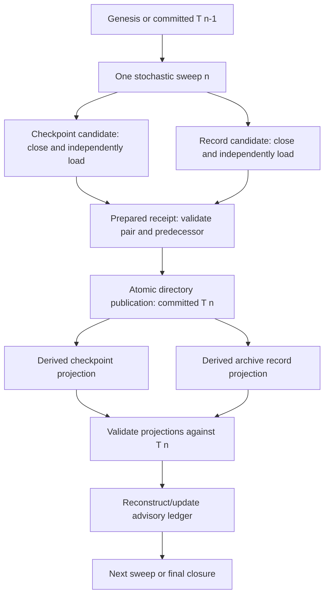

# Historical Layer 9A orchestration design

This is the 2026-11-03 design snapshot, not the current execution guide.
Use [current run and resume interfaces](../WORKFLOW_GUIDE.md#run-and-resume-prepared-artifacts)
for the promoted implementation, readaptation and periodic saving. The original
authorization limits and unresolved statements below retain their dated scope.

Original status: **approved orchestration design; implementation not authorized or validated**. Inspection date:
2026-11-03. Accepted baseline, main and origin/main:
`0317d8dfa0115d11499ae2ddc3f34e624ceb21e5` (Layer 8). This report does not
authorize a scientific run, select K or run lengths, or change Layers 1–8.
The seven rejected Python sketches have been preserved byte-for-byte externally
and removed from active source after copy/manifest verification.

## Explicit approval and sequencing

The user approved the following design choices on 2026-11-03:

- authoritative per-sweep transaction directories and one atomic same-filesystem
  directory publication as the sweep commit point;
- a complete Layer-7 checkpoint and Layer-8 record in every transaction;
- derived, repairable archive/checkpoint projections and retention of all
  committed transactions in the initial implementation;
- a separate atomically published genesis envelope;
- `elapsed_seconds=None` in internal scientific records; measured performance
  timing retained in external attempt/performance receipts;
- exact same-run resume initially; explicit readaptation deferred and rejected
  by the first runner;
- unchanged accepted Layer-5 target acceptance 0.9; historical 0.95 remains a
  documented discrepancy, not an authorized kernel change;
- the accepted Layer-5 CPU environment as the proposed runtime closure;
- no runtime HDF5 helper interpreter.

This freezes design only. Complete the separately authorized canonical full-cell
S10 preparation gate before Layer-9 implementation. Its K=20, nfit=250 and
seed=2026102610 are mechanical smoke settings, not production defaults. All
unresolved input, initialization-equivalence, genesis and transaction-validation
gaps below remain open until evidence establishes them. No Layer-9 implementation
has passed review or tests.

The proposed smallest next capability is one local Windows CPU chain with
authenticated prepared inputs, sequential retained adaptation, complete Gibbs
sweeps, transactional publication, and exact same-run recovery. Explicit
readaptation is specified separately and deferred. No HDF5 helper interpreter
belongs in this runtime.

## Evidence and scope

[LAYER9A_EVIDENCE.csv](LAYER9A_EVIDENCE.csv) records exact paths, byte sizes,
SHA-256 values, inspected line ranges and evidence classes for 73 sources.
Repository paths are relative to the baseline repository. External paths are
machine-local historical evidence, not runtime defaults. Hashes of small source
and receipt files were measured; large matrices and fitted objects were not
reopened or rehashed for this gate. Their identities below are **recorded
accepted evidence**, not new measurements of those external payloads.

Evidence classes used here:

- **H:** authenticated historical source behavior; does not prove execution.
- **A:** accepted canonical source/interface or accepted validation receipt.
- **D:** documented historical claim, including wrapper intentions.
- **P:** engineering design (approved where enumerated above), not an implemented guarantee.
- **G:** missing binding, unresolved discrepancy, or validation still required.

F = `D:\johnston_brain\run_bundles\bsfm_l4_k20_cell50_fmesher_20261026_v1\code`.
C = `C:\Users\Data Viz\Desktop\Anderson_Hail\BSFM_CONSOLIDATION_20261030\source_snapshot\code`.
Driver references below mean `F/sampler/run_c3full_fixed_profile_nuts.py`.
Its F/C copies are byte-identical, 94,890 bytes, SHA-256
`eb452c4c419a7ab55658439fa0105ea609b9eecd6e09b1c27c976c8d5da41c49`.
The selected source identities agree with the existing recovery inventory.
The C copy is corroboration of the same implementation, not independent evidence.

Other central historical sources:

| Source relative to F | Bytes | SHA-256 | Scope used |
| --- | ---: | --- | --- |
| `sampler/full_split.py` | 4705 | `f2b26f954d49dc51dfa542874df0de87936698db7714fca907292a7c495b06cd` | 1–88: transition and adaptation |
| `sampler/restart_state.py` | 6593 | `943a934c35a862bbc8b2d7dd80bc81ea98987e8ef10d9e7cfb152d485094b111` | 1–126: historical checkpoint/RNG semantics |
| `../cloud_run.py` | 6606 | `0c4c4b87aa9020574c2b34125c31a59776a5c4fc3101a194fefa497fa26c8dfc` | 1–131: preliminary wrapper, not completed-run evidence |
| `production/run_adaptation_bridge_chain.sh` | 3042 | `13d1dcf7bf5f8c0c45b893b683d4650444afedb196a5a2f0f1217ea45d1f3a0c` | 1–60: bridge settings |
| `production/run_production_chain.sh` | 3441 | `872d033838e8fec0db8812a5b3dc5288727d7980634a1394e5b8d758087039d3` | 1–68: readaptation settings |

The CSV also identifies the three production code/launch/retention manifests.
Their claims of pilot success do not establish a completed or converged F
campaign. No new historical roots, HPC, or experimental branches were inspected.
No historical source was executed or copied into the repository.

## 1. Runtime scientific-input boundary

The accepted GPINIT *implementation* and the accepted SCT-v2 *production* are
different evidence increments. Their existence does not establish an artifact
join between them.

### Artifact identities and producers

| Input/evidence | Schema and recorded identity | Producer and consumer | Binding and readiness |
| --- | --- | --- | --- |
| Canonical SCT-v2 run receipt | `bsfm.production-run-manifest.v1`; SHA-256 `03b83d93891080f15b6a85684e2cb5de8d9a9b7cdf72f8c25dd8103403e1e06f` | Exact generating commit `6eb672bebbaf5cde6c9d50391aac275a210832a6`; preparation preflight consumes its per-section identities | A: all 19 full-data sections, common depth 124, independently validated. This is upstream evidence, not a sampler array transport. |
| S10 canonical response bundle manifest | `bsfm.modeling-response.full-data.v1`; manifest hash `40e2028f2aeff0cec2e9ba3a23b748702da65947d4637db304a136e52599ff13`; validation hash `73067ad357eea6daaab252f84b1e21f62dd5c217562c11593ded0d457afbbac1` | Same generating commit; offline model-input preparation, then runtime receipt authentication | A: 25,307 all cells; 9,422 modeled cells; MIC/AST/OGC 996/3337/5089; 300/91 genes. Per-dataset identities and six-file hashes exist. G: no inspected preparation receipt joins this response to the accepted GPINIT input. |
| Raw source and registries | Raw hash `d6876020cfdb5cb2fdeb848550e8334cfc2684b6ce6f7755b862cac567f06a38`, 5,483,600,151 bytes; section registry hash `f336de10e58e0b2269ceed62c4c6c454af9956f9460c9097b3d42c7ccf368166`; panel file hash `85707ff1db48b697de58f2b0260daef2d40d6ac6a7710cdfa5e87da422c14f98` | Raw data have no project producer commit. Project adoption is documented in the raw/preprocessing audits; exact SCT producer above binds these identities | A: raw content fingerprint adopted by project, not independently supplied upstream checksum. Runtime retains upstream references; it does not normalize or reopen raw expression. |
| Existing S10 model-input NPZ | `bsfm.gpinit-input.v1` companion contract; NPZ hash `c6356cc2da031e441c1955e831308cc1c3f87ac391845fa40feede1ba97ba4fc` | Historical F `inputs/S10__WT5/OBSERVATIONS.npz`; no authenticated Git generating commit; accepted GPINIT consumed it | A/H: **historical retained population**, 4,712 cells, 91 genes; MIC/AST/OGC 498/1669/2545. Seven array hashes bind its own order. G: not canonical SCT-v2 full-cell Y. |
| Accepted S10 GPINIT review output | NPZ seeds plus `bsfm.gpinit-diagnostics.v1` certificate; output hash `b45851298e01ef3818c6166f950e7717eba144864f517ee7554b15d0d5d27c8e`; certificate hash `247c26f54e6c077788831262a3327f8c8bed8f692565ca68e523605a91ccd04b` | Executed uncommitted review source on baseline `391041a4ff0b7d0d20c7c66c039744ee3c87726c`; source hash `26be9b43ba03908934e3a3d9ebddf0bd6422a7fa5331412266073660a57797c1`. Later code acceptance commit `10cb6e27168aae7581831a6591089b4d88629c49` is **not** its generating commit | A: cold-start equivalence on the historical input, K=20, nfit=250, seed=2026102610. Future initialization may consume only seeds explicitly bound to its exact runtime model input and chosen K. |
| Accepted S10 mesh sampler-facing NPZ | Export receipt `schema_version=1`; NPZ hash `69c4df099766a7d393c570f7d77f6a85fbc88b0c9466f15049f85c3d3536bae0`; 7,195,273 bytes | Executed uncommitted corrected review source; later acceptance `4f732ad08983e0b24aaba9fd99cabc1437e3c98a` is not its generating commit. Consumed through `WarpGeometry` | A: 371 vertices, 708 triangles, 168 full-population active vertices, 167 retained-population active vertices; all 371 modes. G: full source-row/cell-name join to canonical response must be attested. |
| Frozen finite-feature rule | `bsfm.frozen-L16-rule.v1`, registry hash `e39e1597b842b1c71698e9ee180cff3632b6f7b966f9cdaadef1ee13214812d9`; historical NPZ hash `d2add950144186c9e7f46c36df5db75ae13538e5cd65be9b7951781c04a464e5` | Canonical registry introduced at `49f33c441e1cde9e1b8139ffef0103993eaa0222`; original historical generation has no recovered Git commit. `load_rule()`/Layer 3 consume the frozen registry | A: fixed L16/ell_eta=.14 rule; do not regenerate it inside the runner. |
| Runtime model/geometry identities | `bsfm.sampler-input.v1`, `bsfm.sampler-warp-input.v1`; canonical per-array hashes constructed only after authenticating the preparation receipt | Future preparation producer commit and receipt hash are **missing**, not inferred from baseline | A interfaces exist. P: bind both to exact artifact identities, factor order, transformed coordinates, and the same cell population. |
| Same-run restart checkpoint | `bsfm.complete-checkpoint.v1`, `bsfm.checkpoint-contract.v1`; particular hash/producer does not exist for a Layer-9 run yet | Future exact clean generating commit; Layer-7 loader | A format exists. P: checkpoint must belong to a committed transaction and unchanged run/segment/chain/specification. |

Relevant accepted receipts are [SCT production](../preprocessing/audits/20261031_production_v2/README.md),
[GPINIT](../initialization/audits/S10_20261102/review.json), its
[input contract](../initialization/audits/S10_20261102/input-contract.json), and
[corrected mesh reproduction](../mesh/audits/october26_S10_localization_20261102/corrected-reproduction.json).
Every review artifact's missing clean producer commit is explicit; acceptance
does not retroactively make it generated by the subsequent commit.

The S10 historical model-input contract's seven hashes authenticate Y, slocs,
cell codes, cell names, source rows, gene names and type names. For example,
its Y hash is `bb4fb9720baefe581e1dddeffbcc1d44fed60d958153972d33a3f56f1c1922a1`.
It labels Y `final_centered_Y` but contains no canonical response-manifest hash.
That label is not evidence of SCT-v2 origin. GPINIT's input certificate binds
its seeds to that historical NPZ, not to another response with a similar label.

Mesh source rows came from the historical `OBSERVATIONS_BASE.npz`:
`src/bsfm/mesh/october26.py:198–209`. The port checks the historical retained
subset against those rows. This does not alone prove that their namespace is
the canonical H5AD global source-row namespace. Original cell names are not in
the sampler-facing mesh export. Layer-2/3/4 synthetic S10 target checks do not
supply the missing real-expression/cell-identity join.

### Proposed offline preparation receipt

Produce this in a separate approved preparation gate, not by an interpreter
spawned during each sampler launch. It must bind:

1. Exact response manifest, validation receipt, response.h5 identity, raw-source
   fingerprint, panel and section registry identities, and producing code.
2. `/model/centered_response` to NPZ Y **without recentering, transposition
   ambiguity, selection, scaling or logarithms**; Y has shape G × N.
3. The exact ordered 91 genes, MIC/AST/OGC codes 0/1/2, original cell IDs and
   zero-based global raw source rows; type blocks and increasing rows within
   each block. Preserve animal/genotype/section metadata references.
4. Unchanged raw coordinates in `center_y,center_x` order; `source_native` units;
   glial minimum origin and maximum coordinate span, with normalization
   `(coordinates - origin) / scale`. The fit geometry population is the full
   modeled glial population, before any historical thinning. Bind origin,
   scale, population, normalized-array hashes and unchanged axis order.
5. Exact mesh locations, projector rows, cell identity joins, source-row
   namespace, zero-based indices, FEM objects, active support and all modes.
   Do not fill missing cell IDs by relabeling row numbers without a verified join.
6. GPINIT certificate/seed identities, chosen K, exact model-input NPZ hash,
   all seven array identities and ordered factor identities.
7. Preparation producer commit, locked environment identity and comparison
   results. Record both response and sampler logical-hash encodings when they
   differ; do not compare unlike encodings as evidence of inequality.

Then runtime can authenticate the NPZ, contracts and small upstream receipts,
and apply the existing ModelInput/WarpGeometry/GPINIT checks in **one** locked
sampler environment. An offline HDF5 equivalence receipt solves the identified
missing invariants more cleanly; no runtime bridge is justified. It is not yet
available in the inspected evidence. This is a real-data launch blocker, not
a blocker to designing or mechanically testing transactions with synthetic inputs.
Full-data artifacts remain ineligible for primary holdout scoring.

## 2. Initialization lineage and exact RNG chronology

All driver citations below share the authenticated driver hash above. The
accepted APIs are linked through the evidence inventory and Layers 1–8 docs.
Historical formulas are evidence for the proposed composition, not permission
to alter an accepted numerical kernel.

| Operation | H: selected driver behavior and lines | A: available interface | P / G |
| --- | --- | --- | --- |
| Inputs | 335–367, 468–480: Y[G,N], Lam_seed[C,G,K], eta_seed[K,N]; copy seeds literally | ModelInput, GaussianState | Verify exact identities before copying; no GP refit or response rewrite. |
| Global/eta RNG | 466–467: `np.random.seed(seed)` then `default_rng(seed)` | Layer-1 global RNG and explicit eta Generator | Seed is explicit in run spec; capture both states, not only the seed. Initialization must reproduce the global sigma2 draw before subsequent draws. |
| Alpha | 477: `maximum(eta.std(axis=1), 1e-3)` with NumPy default ddof=0 | GaussianState/PX | Preserve exact reduction/dtype/operation order; no rescaling of the GPINIT eta before this operation. |
| Sharing/shrinkage | 481–485: s=.20; phi[G,K]=1; delta[K]=1; tau=cumprod(delta) | Layer 1; fixed sharing | These are deterministic initial values, not prior draws. |
| Zeta/ranges | 489–492: zeta=.5; factor range at supplied fixed center; warp ell and sigma at supplied centers | Layer-3/4 positions; fixed factor range .14 | Selected direct-W chart starts log-ell=0/log-r=0 for the recovered center ell=1; retain accepted range/amplitude law. |
| Noise scale/draw | 493–496: v=1; b_sigma2=.25 var(Y,axis=1); Yhat from original seed arrays; `sample_sigma2_twostage(Y,Yhat,v,2,b)` | Layer-1 `compute_Yhat`, `sample_sigma2_twostage` | Preserve global NumPy gamma draw and formula, before PX. Reject invalid noise scale through existing checks; no new variance floor. |
| Initial PX | 510–516: gauge Generator(seed+3003), one `refresh_alpha_gauge`, label `gpinit_initial`, check fitted signal | Layer-1 PX with its accepted invariant checks | Preserve alpha-draw/gauge arithmetic and chronology; record before/after identities and PX audit. No second initialization PX. |
| Direct-W identity field | 517–538: active QR root at mu_log_ell; center=mean(slocs); active vertices minus center; triangular solve of identity/sigma_prior; flatten zW in row-major order | WarpGeometry, DirectWTarget, scipy triangular solve, exact chart/state helper | Preserve supplied initial sigma literal `0.31622776601683794` used by selected wrappers. Do not assume algebraically equivalent rewrites give identical floats. Compare this initialization explicitly before adopting sketch arithmetic. |
| Projection check | 528–532: A_active @ (sigma_prior L zW) agrees with slocs-center at atol=rtol=1e-9 | Layer-2 projector and physical-W checks | Initialization is a centered identity **direct-coordinate** field, not zero direct-W; do not confuse with a displacement parameterization. |
| JAX keys | 662–665: split PRNGKey(seed+1) into K+1; first master, remaining warmup keys in factor order | Layer-5/6 key APIs; Layer-7 key codec | Explicit key implementation/data and offsets are retained. Never derive a resumed master key from seed. |
| Diagnostic-only RNG | 666–670: pair Generator(seed+88001) for fidelity pairs | No selected Layer-1–8 fidelity evaluation | Excluded from proposed minimal runtime; record `fidelity_status=not_evaluated_by_layers_1_to_8`. Do not claim historical fidelity diagnostics ran. |
| Factor order | 697 natural 0..K-1 in warmup; 1179–1188 global random permutation then JAX split in sweeps | Layer-5 ordered factor IDs; Layer-6 random visitation | No permutation during initialization/adaptation; do not replace global-RNG sweep permutation with a new Generator. |

The sigma2 conditional is inverse gamma via the accepted global-RNG gamma
operation: shape `2 + N/2`, scale parameter for that gamma draw
`1/(b_sigma2 + RSS/2)`, followed by reciprocal. The implementation's exact
array/reduction operations, not a rewritten formula, define draw equivalence.
PX samples the auxiliary log-alpha using the accepted mean log(.7), variance .7
and preserves B=alpha×Lambda, eta/alpha, fitted response and loading quadratic.
The accepted Layer-1 source map is the authority for those extracted formulas.

Seed policies must not be conflated. F's preliminary cloud wrapper uses
`2026102700 + section_index`; the bridge/production wrappers use
`2026102400 + section_index*100 + chain_index`. GPINIT's recovered seed is
`2026102600 + section_index` and belongs to an earlier, separate computation.
These are historical wrapper settings, not a newly chosen production seed policy.

## 3. Sequential adaptation and the post-warmup boundary

H: driver 671–734 and 906–973 adapts factors sequentially. Each factor's
leave-one-factor-out residual/statistics are computed from the work state
including previous factors' retained endpoints and eta draws. The other
conditional quantities stay fixed during that factor's adaptation. The split
kernel adapts field and hyper blocks, then rewhitens; it does not draw eta.
After the endpoint, the driver updates position, alpha, zeta and warp summaries,
then draws **one** factor eta using the explicit eta Generator (924–927).
Only then does the next factor start. There is no joint-eta refresh between
the two NUTS blocks or an extra reset to GPINIT after warmup.

H: `full_split.py:19–88` uses separate diagonal adaptation states, initial
steps .01, scheduled warmup of at least 20 transitions, and retained field/hyper
steps plus packed inverse mass. Its warmup keys come from the factor key;
the master sweep key is unchanged. Global NumPy and gauge RNGs do not advance
in this adaptation composition; eta Generator advances after each factor.
Driver 942–949 commits the coherent final work state to memory.

A: Layer 5 exposes `SplitTransition.adapt` and authenticated endpoints/tuning;
Layer 3 exposes the single-factor eta draw; Layer 4/5 share the accepted exact
chart/state relationship. P: compose these public interfaces, validate every
endpoint and keep full factor order, conditional identities, before/after
states, key data, eta audit, adaptation histories and warnings. Do not introduce
a new target or reach into private kernels to bypass context authentication.

**Historical setting discrepancy:** the bridge and preliminary cloud wrapper
request target_accept=.9; production readaptation requests .95. Accepted
Layer 5 fixes .9, depth 10 and initial .01 steps. Proposed Layer 9 composes the
accepted .9 implementation unchanged. It must not claim to reproduce the .95
production wrapper. Changing that accepted constant would be a separate approval.
Warmup, settling and production lengths remain explicit, unselected run inputs.

The frozen endpoint contains the complete Gaussian state, ordered positions,
all-factor tuning, b_sigma2, input/target/rule/geometry identities, **exact full
spectral chart**, global NumPy state, eta/gauge Generator states, master JAX
key, warmup key lineage, initialization audit and complete adaptation evidence.
Its audit distinguishes warmup diagnostics from subsequent settling/production.
Divergences and nonfinite divergent-block energies remain explicit through the
existing diagnostic encoding. A finite endpoint with a recorded divergence is
not automatically a failed numerical computation or evidence of adequate mixing.
Nonfinite state, failed PCG or failed invariant is terminal, not a warning.

**G: no accepted zero-sweep checkpoint API.** Driver 1107–1112 historically
writes a post-warmup checkpoint at local sweep 0. Layer 7 deliberately requires
a completed `SweepResult` and local sweep >=1. Do not fabricate one. P: a
separate versioned `pre-sweep-endpoint` envelope, validated independently with
the accepted state/chart/tuning/RNG interfaces, lives in an atomically published
genesis directory. It is not a retained record or a Layer-7 completed checkpoint.
The provisional serializer is insufficient until it binds the complete spectral
chart and passes independent exact readback. This is a small new orchestration
boundary requiring review, not a reason to relax Layer 7.

No stochastic sweep starts before genesis publication/readback. If initialization
or adaptation is interrupted before genesis commits, the whole uncommitted
initialization/adaptation attempt can be recomputed from authenticated inputs
and identical initial seeds. The minimal design does not promise mid-warmup
continuation. A committed genesis is restored, never readapted on exact resume.

## 4. Approved design contract and remaining implementation details

All items in this section are P. The explicit choices above are approved;
implementation/API details and their tests remain subject to review.

- One explicit run, segment and chain identity; one cooperating writer; one
  local supported filesystem. No ensemble launcher or automatic chain selection.
- Immutable run/segment specifications bind clean generating commit, complete
  accepted environment identity, input/preparation/GPINIT/mesh/rule hashes,
  K and ordered factor IDs, seed policy, requested adaptation/settling/production
  counts, retention cadence, checkpoint-exposure cadence, warnings/timing policy,
  and resource policy. No hidden scientific defaults or extension in place.
- Runtime authenticates precomputed NPZ/contracts. It never transforms Y,
  fits SCT/GPINIT, rebuilds a mesh, or silently substitutes inputs/environments.
- Genesis is the sole accepted zero-sweep endpoint. Each subsequent complete
  sweep uses the accepted Layer-6 chronology exactly once per accepted index.
- **Each sweep commits a checkpoint and a completed Layer-8 record together**,
  including nonretained sweeps. The record's existing retention predicate and
  16 retained fields are unchanged. Failed attempts never count as completed.
- Same-run recovery restores the last committed boundary and all four RNGs;
  no readaptation, thinning changes, run-length edits or new seeds.
- Committed transaction candidates are immutable. Archive/checkpoint projections
  and ledger are downstream representations, never competing authorities.
- Exact resume requires the same spectral chart and target identities.
  Recomputed eigensystem signs/ordering cannot silently replace the saved chart.
  Bind the chart in genesis and checkpoints; independently validate any restored
  chart against authenticated geometry. If existing interfaces cannot restore
  it without recomputation, that is a bounded API task to review, not a tolerance
  waiver. Existing Layer-7 mismatch rejection remains unchanged.
- Completion certifies requested computational work and artifact consistency,
  not convergence, scientific adequacy, GPU portability, or posterior validation.

## 5. State transitions

The state column is a logical state derived from evidence, not authority granted
by a mutable ledger string. A live process can be in a transient state while
the last durable state remains the previous transaction.

| Transition | Required durable inputs | Stochastic work / outputs | Atomic boundary and recovery | Forbidden |
| --- | --- | --- | --- | --- |
| Absent → CREATED | Explicit immutable specification; fresh root, exclusive writer | None; publish run and segment specifications | Create-once files, readback; partial creation is an attempt, not a runnable run | Overwrite incompatible root/spec; infer inputs by filename |
| CREATED → INPUTS_AUTHENTICATED | Spec, expected code/environment/input identities | None; input receipt and authenticated target/geometry/chart evidence | Immutable receipt publication; incomplete receipt can be rebuilt read-only | Continue on dirty tree, missing preparation link or unknown package identity |
| INPUTS_AUTHENTICATED → INITIALIZED | Receipt and explicit seeds | Historical sigma2/PX draws; initialization audit in attempt | Not yet a committed chain endpoint; recompute whole attempt after interruption | Export a completed sweep/retained draw |
| INITIALIZED → ADAPTING | Valid initialization attempt, ordered factors/keys | Sequential adaptation + one eta per factor; full histories | Attempt only until coherent endpoint exists | Simultaneous factor adaptation; resetting warmed factors |
| ADAPTING → READY_FOR_SWEEP | Independently validated complete endpoint and histories | Publish genesis; no additional random draws | Same-filesystem genesis-directory publication then readback | Start sweep with incomplete warmup or forged sweep 0 checkpoint |
| READY_FOR_SWEEP → SWEEP_IN_PROGRESS | Valid genesis or latest committed transaction; projections repaired; writer lease | Exactly one Layer-6 sweep in memory with canonical sweep label | No commitment yet; interruption permits deterministic recomputation | Resume from stale exposed checkpoint; reuse advanced in-memory RNG after failure |
| SWEEP_IN_PROGRESS → TRANSACTION_PREPARED | Complete SweepResult and matching live RNG endpoints | Write/close/read back Layer-7 checkpoint and Layer-8 record; prepared receipt | No new stochastic calls; failed/partial candidate has no accepted-sweep status | Publish one candidate as authoritative; construct missing stochastic arrays |
| TRANSACTION_PREPARED → TRANSACTION_COMMITTED | Valid pair, previous chain head, exact next index | None; rename whole transaction directory | This rename is the sweep commit point; reopen/validate result | Overwrite an existing transaction; skip index; replay after commit |
| TRANSACTION_COMMITTED → PROJECTIONS_VALIDATED | Committed pair and prior verified chain | None; checkpoint/archive projections and validation | Each projection publishes atomically; recover by copying exact committed bytes | Rerun sweep to repair projection; trim conflicting archive |
| PROJECTIONS_VALIDATED → READY_FOR_SWEEP | Current head and exact boundary | Advisory ledger update only | Ledger can be reconstructed if update is lost | Treat ledger as head authority |
| READY / PROJECTIONS_VALIDATED → PAUSED | Valid durable boundary; optional stop receipt | No stochastic work | Resume same spec from head; a pause need not coincide with exposure cadence | Label a partial sweep complete |
| Any active state → FAILED | Failure receipt identifies stage and last committed head | Preserve attempts and exception/warning evidence | Known numerical/identity failures stop; no automatic retry | Downgrade failed invariant to warning; delete evidence |
| Final PROJECTIONS_VALIDATED → COMPLETE or COMPLETE_WITH_WARNINGS | All requested transactions, repaired projections, closure authentication and independent aggregate validation | None; publish completion manifest | Atomic immutable manifest publication; then advisory ledger | Complete on process exit, directory existence or partial count |

An interrupted process without a recorded terminal numerical failure is not
automatically a scientific failure. Recovery classifies durable evidence first.
A recorded numerical failure is terminal pending review even though its attempt
never committed. A pause/OS interruption before commitment permits replay of
that **uncommitted** attempt under the same validated conditions.

## 6. Per-sweep transaction and authority



Preparation and publication:

1. Acquire exclusive run ownership before reading a mutable head. Record owner
   metadata; never steal a lease merely because a PID looks absent on another
   machine. Stale-owner recovery must prove no live cooperating writer. Two
   writers must not advance the same chain. Exclude symlink/reparse redirection
   and cross-filesystem attempt placement from the supported publication path.
2. Determine n from the validated contiguous transaction chain, not the ledger
   or largest filename alone. Validate genesis or T[n-1] and exact RNG endpoints.
3. Call Layer 6 with a stable label derived from segment/chain/sweep, never an
   attempt UUID. Synchronize device results before serialization. Hold the
   coherent result and endpoint RNGs without further stochastic operations.
4. In `attempts/<attempt-id>/transaction/`, construct `checkpoint.npz` with the
   existing Layer-7 writer, using this fresh candidate destination. Construct
   `record.npz` through `retained_records.make_completed`, ordinary closed NPZ
   serialization, and the public `load_record`; do not invoke archive.append
   as the authoritative commit. Close/flush files before independent readback.
5. Independently load both. Require equal target/run contracts, exact sweep and
   production progress, state/position after hashes, label and all four RNG
   endpoints. Compare record before-boundary to T[n-1] or genesis; after-boundary
   to checkpoint. Validate frozen tuning, exact spectral chart, retention index,
   record predecessor, identities and all existing Layer-7/8 invariants.
   Both retained and diagnostics-only records undergo boundary checks.
6. Write/close/read back immutable `prepared.json`. It identifies run, segment,
   chain, n, previous transaction identity, genesis, specs, contracts, exact
   checkpoint and record byte counts/hashes, their existing logical hashes,
   and joint-validation result. No stochastic output is inferred from a hash.
7. Publish the **entire** three-file directory with a no-overwrite, same-filesystem
   rename into `transactions/00000000000n`. Publication plus successful reopened
   authentication determines commitment. A crash after rename and before the
   caller receives confirmation is recovered as committed if the directory
   validates; do not replay based on the caller's last status variable.
8. Derive each archive record directory and exposed checkpoint by copying exact
   committed candidate bytes into fresh projection attempts and publishing
   atomically. No hard links to mutable paths. Compare preexisting projections
   exactly; missing projections can be restored. A conflicting existing
   projection is an integrity failure, not permission to overwrite or trim it.
9. Reopen the archive and call its existing continuity/resume checks against
   the committed head checkpoint. Update the ledger only after this validation.
   No Layer-8 API needs relaxed ahead/behind acceptance: repair the derived
   view first, then use the existing strict validator.

The prepared receipt is the commit receipt in its final location; there is no
second mutable marker whose absence makes an already published transaction
ambiguous. Only receipt-authenticated directories in `transactions/` are accepted.
A receipt under `attempts/` is merely prepared, even if both files are valid.

**Hash chain.** Use the existing canonical JSON and logical-array encodings.
Define H0 from immutable specs, input receipt and genesis identity. Each receipt
body includes H[n-1], n, the exact record logical hash, checkpoint logical hash,
their byte hashes/sizes and the complete contract identities; H[n] is SHA-256
of that body, excluding its own digest. The Layer-8 record keeps its existing
separate predecessor chain (first previous hash = retained-contract hash).
Verify both chains and cross-bind them; do not replace Layer-8 encoding.
File/receipt hashes may differ across independent new executions because NPZ
serialization or measured timing can differ; they are exact artifact identities,
not a claim of cross-run stochastic equality. Already committed receipt/record
bytes are never regenerated on recovery.

If exactly one complete, independently valid prepared next transaction exists
after interruption, recovery may finish publishing it without stochastic work.
If there is no complete valid pair, preserve the partial attempt and recompute
from the preceding committed boundary and identical RNGs. Never assemble a pair
from unrelated attempts. Multiple conflicting valid prepared candidates require
inspection; do not choose by timestamp. A corrupt committed transaction is
terminal; never roll back silently to an earlier checkpoint.

**Reasoning under the stated filesystem/single-writer assumptions:**

| Property | Reason |
| --- | --- |
| No duplicate accepted sweep | Unique index, explicit predecessor and no-overwrite whole-directory publication; a validated existing T[n] is authoritative. |
| No skipped accepted sweep | Validation requires exactly the contiguous sequence 1..n, predecessor hashes and before/after state/RNG continuity. |
| No accepted record/checkpoint disagreement | Both files are independently validated and cross-bound before the only commit point; later modification invalidates their receipt. |
| No committed stochastic replay | Recovery authenticates transactions before attempts or projections and resumes at n+1; projection repair calls no sampler/adaptation code. |
| No partial sweep counted | Partial state lacks a complete independently validated pair and committed directory. Completed computation in RAM alone is still uncommitted. |
| No silent trimming/replacement | Committed directories and accepted projection files have no overwrite path; unexpected extra/conflicting files cause failure. |

These are protocol arguments, not executed crash tests. Atomic rename is a
namespace-publication assumption on the supported local filesystem, not a
backup or a universal power-loss guarantee. Flush/close both payloads and receipt;
test process-kill recovery and platform durability before a production claim.
If power loss leaves missing/corrupt committed storage, fail authentication;
do not pretend the chain can be reconstructed from missing stochastic results.

## 7. Cadence, retention and completion

Every committed transaction retains its complete checkpoint and completed
record, whether or not that sweep retains the 16 draw fields. The latest
exact-resume state is always T[n].checkpoint. `checkpoint_every=c` controls
only an exposed historical-checkpoint projection (multiples of c and final),
not whether durable resume state exists. An advisory latest pointer can point
to T[n]; it is reconstructed from the chain, never trusted over it.

Example with c=5: after sweep 7 commits, exposed historical checkpoints may
contain only sweep 5. Restart still loads the checkpoint in T[7], validates
archive head 7, and continues at 8. If record projection 7 is absent it is copied
from T[7]; no sweep 7 is rerun. If interruption occurs during uncommitted sweep 8,
restore T[7] and recompute 8, including all RNG restoration.

Minimal cleanup policy: retain **all committed transactions**, genesis, terminal
failures and partial attempts. No garbage collection in the first implementation.
Optional duplicate checkpoint projections are reconstructable but are not
silently removed. This storage cost is intentional for initial correctness;
a future compact/backup policy needs its own approved contract. Directory
existence, an exposed checkpoint cadence, or retained-draw cadence is never a
completion criterion.

Completion requires all requested sweeps in order, exact retention predicate,
all contracts and source/environment/code reauthentication, independent
transaction validation, projection consistency, no terminal failure, and a
validated diagnostic aggregate. Publish a fresh immutable completion manifest
with final head/checkpoint/record identities, counts, warnings and limitations.
Then update the advisory ledger. A lost ledger update is harmless. A missing
manifest after final sweep permits **closure-only** recovery, not another sweep.

`COMPLETE_WITH_WARNINGS` includes visible warmup/sweep divergences and supported
warning events. Do not conflate historical fidelity warnings with canonical
diagnostics: the former fidelity checks are not implemented by Layers 1–8.
Always report `convergence_status=not_assessed`; do not introduce ESS/R-hat or
scientific fit claims. Failed invariants cannot become successful warning status.

For deterministic scientific comparisons, propose the already supported
Layer-8 `elapsed_seconds=None` with an explicit not-measured-in-record meaning;
keep measured timing in external attempt/performance receipts. This is a Layer-9
policy choice, not a change to Layer 8. If actual elapsed time is embedded in
records instead, cross-execution record hashes and elapsed diagnostics cannot
be promised identical. Tests must use a deterministic clock to require exact
complete diagnostic equality, while real timings remain honest observations.
Committed repair preserves timing and warning evidence exactly whichever
immutable policy was chosen. Do not suppress nonfinite divergent energy or
convert it to null; the canonical explicit nonfinite tags remain in force.

## 8. Exact resume versus explicit readaptation

| Operation | Contract |
| --- | --- |
| Exact resume (proposed initial capability) | Same immutable run/segment/chain/spec, inputs, committed code, environment, target chart, archive and tuning. Authenticate chain, finish prepared publication or repair projections, restore latest checkpoint and all four RNGs, continue next uncommitted sweep. Never run adaptation or GPINIT initialization after genesis. |
| Explicit readaptation (defer implementation) | New child run/segment ID and its own archive/genesis/transactions. Bind exact parent run/segment/chain, spec, committed transaction, checkpoint byte/logical hash, parent archive head and sweep. Parent remains immutable. Child has explicit new adaptation-key policy, full warmup evidence and frozen endpoint. |

No child output is appended to the parent's scored archive; no automatic
parent/child pooling or aggregation-as-one-chain. The future analysis policy
must explicitly decide any pooling. Historical local segment reset/readaptation
does not establish that policy. Child warmup lengths, seed/key handling and
settling need an approved specification; they are not inherited by accident.
The initial CLI should reject readaptation as unsupported instead of presenting
partial behavior as canonical. Same-run resume must not require editing its
original immutable specification to set warmup to zero; the operation itself
skips already committed initialization/adaptation.

## 9. Environment and dependency closure

**A:** the accepted Layer-5 CPU environment provides the imports required by
the proposed NPZ-only composition. This conclusion follows from accepted imports
and lock/restore receipts, not from an unversioned executable discovered nearby.
No package or runtime was loaded/built/installed for this documentation gate.
This does not authenticate the environment's present disk contents for a future
launch; launch preflight must perform the accepted validation again.

| Function | Direct requirements | Binding/check |
| --- | --- | --- |
| File/receipt/hash/spec authentication | Python stdlib pathlib/hashlib/json/os/subprocess; NumPy for nonpickle NPZ | Exact commit, schemas implemented by canonical validators, expected external artifact identities; Python executable hash alone is insufficient |
| Model/mesh/rule authentication | NumPy/SciPy and existing canonical APIs | Explicit identities, ordering, sparse/dense conventions; no R/fmesher, h5py or scikit-learn in runtime |
| Initialization | NumPy global RNG + Generators, SciPy triangular solve, JAX keys, Layers 1–3 | Exact pinned arithmetic/RNG implementation and source-driven regression |
| Adaptation | JAX/JAXlib, BlackJAX and resolved dependencies; Layers 3–5 | CPU/x64, accepted thread behavior and immutable kernel constants |
| Gibbs sweep | NumPy, SciPy, JAX/JAXlib, BlackJAX; Layers 1–6 | Public Layer-6 chronology, four RNG endpoints |
| Checkpoints/records/transactions | NumPy + stdlib + accepted Layers 7–8; JAX for target validation | Nonpickle arrays, explicit nonfinite diagnostics, closed-file validation; no new serializer dependency |
| Independent validation | Same locked runtime, accepted public validators, stdlib file checks | No unlocked helper interpreter; separate process with authenticated target/chart |
| Upstream HDF5 preparation | Separate already accepted, fully receipted preprocessing environment, subject to an explicit preparation gate | Outside sampler runtime; authenticate h5py/NumPy/HDF5 and all packages, not just python.exe |

Recorded runtime: Windows x64 Python 3.12.0, pip 23.2.1. Resolved packages:
NumPy 2.1.3; SciPy 1.14.1; JAX/JAXlib 0.7.0; BlackJAX 1.3;
ml-dtypes 0.6.0; opt-einsum 3.4.0; threadpoolctl 3.5.0; jaxopt 0.8.3;
optax 0.2.8; fastprogress 1.0.3; absl-py 2.5.1; typing-extensions 4.16.0.
Lock, wheel hashes, runtime files, isolation and offline restoration are recorded
under [environment/sampler-layer5](../../environment/sampler-layer5/README.md).
The evidence CSV records those files' measured hashes. Python 3.11.14 is the
historical runtime, not the accepted Windows runtime; no silent equivalence claim.

Proposed environment is this accepted CPU closure, bound to its full lock and
receipt. Validate actual distributions, module/library locations, disabled user
site, runtime identity, CPU/x64, architecture, BLAS/thread configuration and
recorded wheel/install identities. No extra jsonschema/psutil/h5py dependency is
assumed. Use stdlib orchestration and accepted validators; if implementation
later adds a dependency, it must return through environment review.

Future reproducibility gate: restore into a fresh root using the authenticated
runtime and hash-locked cached wheels, no-index/no-deps/no substitution; compare
package/runtime/BLAS/isolation identities and repeat small initialization,
continuation, transaction and projection tests in fresh processes. Existing
offline Layer-5 restoration is evidence for package feasibility, not an already
passed Layer-9 restoration/transaction test. No GPU/Linux/HPC readiness is claimed.

Documentation inconsistency retained for review: Layer-5 environment README and
source-lock still say proposal/review, despite accepted Layer-5 source and
validation. The frozen response configuration also retains an old
`frozen_design_not_implemented` status. This gate does not rewrite those hashed
records or confuse stale wording with changed numerical/environment identities.

## 10. Proposed run-root layout

```text
run-root/
  run-spec.json                         authoritative immutable run identity
  input-receipt.json                    authoritative upstream preparation binding
  segments/<segment-id>/
    segment-spec.json                   authoritative chain, policy, optional parent binding
    genesis/                           authoritative atomic pre-sweep endpoint
      endpoint.npz                     complete state/chart/tuning/RNG; not a sweep record
      initialization.json              exact initialization audit
      adaptation.npz                   complete histories and endpoint bindings
      receipt.json                     identities/hashes/independent readback
    transactions/
      000000000001/                    authoritative, immutable, atomic sweep commit
        checkpoint.npz                 complete Layer-7 checkpoint every sweep
        record.npz                     complete Layer-8 record every sweep
        prepared.json                  joint validation and predecessor/file/logical identities
      ...
    attempts/<attempt-id>/             debugging/uncommitted evidence; never consumed as completion
      transaction/...                  recoverable prepared pair or incomplete candidates
      attempt.json / logs / timing     attempted phase, interruption and performance evidence
    archive/                           derived; existing Layer-8 archive format
      contract.json
      records/000000000001/record.npz   exact copy of committed record
    checkpoints/                       derived exposed historical cadence
      000000000005.npz
    latest.json                        advisory pointer to authoritative transaction checkpoint
    run-ledger.json                     advisory/reconstructable state, never authority
    failures/<failure-id>.json          immutable failure evidence, tied to stage/head/attempt
    completion.json                    authoritative closure receipt, independently recheckable
  writer.lock                          coordination only; no scientific completion authority
```

Names and new envelope schemas are proposals, not frozen files created by this
gate. Retain Layers 7–8 schemas and encodings unchanged. A validation reader must
not treat a temporarily incomplete projection as a complete run; require run-level
projection validation for the current transaction head. Failures belong outside
the successful transaction chain. Do not call `archive.record_failure` for a
recoverable OS interruption and thereby terminally poison an otherwise resumable
archive. Known numerical failures get explicit terminal failure receipts.

## 11. Failure/recovery matrix

Here G0 means committed genesis, Tn the latest committed transaction. All attempts
and failure receipts are preserved; none are counted as completed sweeps.

| Interruption/failure point | Durable authority | Permitted restart/recomputation | Reject / evidence retained |
| --- | --- | --- | --- |
| Before/while run-spec publication | None or valid immutable spec | Finish creation only after exact spec authentication | Incompatible existing root; retain partial creation evidence |
| During input/environment authentication | Spec, no authorized stochastic work | Repeat read-only authentication | Changed/missing identity; preserve failure receipt |
| During initialization | Input receipt, partial attempt | Recompute uncommitted initialization from initial seeds | Continue partially advanced RNG; retain initialization attempt |
| During sequential warmup | Input receipt, partial histories | Recompute entire uncommitted initialization/adaptation | Claim partial factor sequence is frozen endpoint |
| After warmup before genesis commit | Prepared endpoint at most | Validate/publish complete prepared genesis, else recompute uncommitted work | Forge sweep 0; combine unrelated attempts |
| After genesis commit before ledger | G0 | Restore G0; reconstruct ledger; no warmup replay | Reset to GPINIT |
| Before next sweep | G0/Tn | Restore exact boundary and start n+1 | Resume stale projected checkpoint |
| During sweep | G0/Tn; partial RAM/attempt | On OS interruption recompute n+1 from exact prior RNG; known numerical error stops for review | Publish partial SweepResult, skip index |
| After completed sweep before either candidate | G0/Tn only | Lost RAM result is uncommitted; recompute n+1 deterministically | Claim computation alone means commitment |
| After checkpoint candidate only | G0/Tn; uncommitted checkpoint candidate | If complete matching record later exists validate pair; otherwise recompute from prior boundary | Invent missing record/diagnostics from checkpoint |
| After record candidate only | G0/Tn; uncommitted record candidate | If complete matching checkpoint exists validate pair; otherwise recompute from prior boundary | Reconstruct missing RNG/state from retained draw |
| Both candidates before prepared receipt | G0/Tn; complete pair possibly recoverable | Independently validate and build receipt from existing candidates only; publish without stochastic calls if valid | Missing boundary evidence, mismatch or mixed attempts |
| Prepared receipt before directory rename | G0/Tn; valid prepared pair | Finish no-overwrite commit after predecessor validation | Conflicting next prepared transactions |
| During/after directory rename before caller acknowledgment | Either old head or valid T[n+1] | Inspect namespace and authenticate; if committed never replay | Treat ambiguous I/O exception as permission to rerun |
| After transaction commit, before either projection | T[n+1] | Copy both projections from transaction; no RNG calls | Derive progress from empty archive alone |
| After archive record projection only | T[n+1] plus record projection | Repair checkpoint projection; existing record must match | Trim archive to stale checkpoint |
| After checkpoint projection only | T[n+1] plus checkpoint projection | Repair archive projection; existing checkpoint must match | Rerun sweep to obtain record |
| After both projections before ledger | T[n+1] and exact projections | Validate and reconstruct ledger | Rerun committed sweep based on stale ledger |
| During ledger replacement | T[n+1]; valid old/new/torn advisory ledger | Ignore untrusted ledger, derive from chain and projection validation | Use ledger count to skip work or accept missing transactions |
| Extra projection without committed transaction | Valid transaction chain only | Stop for integrity review; retain extra file | Silently trim, adopt or overwrite orphan projection |
| Corrupt/gapped committed transaction | Corrupt evidence, not a valid resumable prefix beyond gap | Stop; no automatic fallback/reconstruction | Drop transaction and replay it; claim success from earlier prefix |
| During final input/code/environment checks | Full chain; no completion | Rerun read-only closure only after identities remain valid | Complete on failure or silently accept drift |
| During completion-manifest publication | Full chain/projections; candidate or final manifest | Validate existing final or publish a valid candidate; no sweeps | Overwrite conflicting manifest; complete an incomplete chain |
| After completion before final ledger | Valid immutable completion and chain | Reconstruct ledger; return completion | Extend immutable run in place or launch another sweep |

The formerly discussed cases “record published only,” “checkpoint published
only,” and “both published before commit” must be distinguished: authoritative
candidate files are private inside an attempt until the **single directory
publication**. Individually visible archive/checkpoint publications occur only
after transaction commitment and are repairable projections. That eliminates
the old two-authority ordering rather than trying to guess which file wins.

## 12. Proposed mechanical validation matrix

No tests below were executed for this design gate. Existing Layer-8 acceptance
records remain unchanged; their results are not relabeled as Layer-9 results.

| Test | Exact assertion / rejection |
| --- | --- |
| Historical initialization fixture | Authenticated bounded driver/reference extraction, identical GPINIT/state/seed; exact loading, eta, alpha floor, sigma2, shrinkage, zeta, zW, all RNG states; compare literal sigma initialization arithmetic. Stop on unexplained draw inequality. |
| Sequential warmup fixture | Two or more factors; exact natural order, conditional contexts, warm keys, endpoint propagation, one eta per factor, retained tuning/history and unchanged master/global/gauge RNG during adaptation. Compare selected .9 split path, not .95 wrapper. |
| Genesis readback | Fresh process reconstructs complete state, exact chart, tuning and four RNG states; rejects missing spectral data, forged sweep result or incomplete histories. First sweep before-hashes must equal genesis after-hashes. |
| Uninterrupted vs interrupted | Same synthetic state and explicit seeds; inject every row of the failure matrix. Compare final complete state, positions, tuning, all 16 retained fields, numerical diagnostics, audit identities and four RNG endpoints exactly. Fixed clock/events for full-record equality; report timing separately otherwise. |
| Prepared recovery | Checkpoint-first and record-first writes; complete valid pair finishes without sampler calls; lone candidate is preserved and recomputed from previous committed state; different attempts cannot be mixed. |
| Commit uncertainty | Kill before rename, after rename and before acknowledgment; recovered index either old or new by authenticated directory, never double advancement. |
| Projection repair | Delete/miss each derived projection in turn; reconstruct exact bytes with sweep/adaptation functions replaced by fail-on-call sentinels. Test both publication orders and ledger-update failures. |
| Cadence >1 | Explicit small schedules with checkpoint_every 2, 3 and 5 and interruptions at nonmultiples; latest transaction checkpoint resumes exactly; exposed cadence differs only in redundant projections. |
| Retention chronology | Settling, first/modulo/final cases, nonretained metadata-only records, final sweep off cadence; no duplicate retained index or omitted completed record. |
| Corruption/ownership | Missing/extra/mismatched candidates, byte/hash/contract mutations, broken predecessors, wrong index, duplicate IDs, conflicts, stale prepared attempts, two writers; fail closed without replacing accepted files. |
| Exact same-run resume | Same spec/chain/archive; no initialization, adaptation or extra RNG draws after genesis. Drift in seed, cadence, K, factors, run length, input, environment or commit fails before stochastic work. |
| Identity/environment gate | Dirty tree, wrong generating commit, package/module-path or runtime/lock mismatch, changed input/receipt/mesh/GPINIT/rule rejected. HDF5-helper invocation is forbidden in runtime tests. |
| Full-data preparation join | Historical retained NPZ supplied as canonical full-cell input must fail; wrong source-row namespace, reordered cells/genes/types, coordinate transform or GPINIT input hash must fail. |
| Diagnostics | Preserve field/hyper order, divergence flags and explicit nonfinite energy tags; no illegal JSON Infinity/NaN. Numerical failure cannot become complete-with-warnings. |
| Closure | Missing sweep, unrepaired projections, terminal failure or altered inputs prevents completion manifest. Valid final-chain recovery performs closure only; existing complete manifest is immutable. |
| Readaptation boundary | Initial implementation rejects readaptation with no parent mutation. If later implemented: exact parent head binding, separate child identities/archive, explicit warmup, no pooling; byte inventories prove parent unchanged. |
| Offline restoration | Fresh locked CPU environment; repeat bounded fixtures/continuation/projection tests, authenticate package/BLAS/runtime identities; no network resolution or substitution. |

Unit fault injection alone is insufficient for publication claims: add bounded
fresh-process kill tests at file close, directory rename and projection/ledger
boundaries on the supported local Windows filesystem. No real section or long
scientific run is needed to establish these mechanical properties.

## 13. Rejected sketches and stable external preservation

The original review left all seven sketches untouched. Subsequent explicit user
approval rejected them as implementation attempts, not future source. All seven
were copied byte-for-byte, verified, and then removed from the repository working
tree. No sketch was executed or imported into Git. The evidence CSV now names
the stable capture paths and retains the original repository paths in its
authority field.

External capture root (machine-local):
`C:\Users\Data Viz\Desktop\Anderson_Hail\BSFM_RECOVERY_EVIDENCE\layer9_initial_sketches_20261103`.
Its `manifest.json` records original/capture paths, sizes and hashes: 4,299 bytes,
SHA-256 `7733ed9aa3d17bb093df49721570a450dc43b539b816505582a4fb35c8770166`.
All seven capture sizes and hashes were independently rechecked before removal.

The following table preserves the original conceptual assessment, not authority
to recover these rejected files as future source. Future implementation must
follow the approved design and accepted Layer interfaces.

| File under `src/bsfm/sampler` | Disposition after design approval | Reason |
| --- | --- | --- |
| `production_run.py` | Rewrite; retain explicit clean-launch concept | Remove second-interpreter launch and prior-root assumptions. Distinguish same-run recovery from a future child segment; authenticate transactions before choosing state. |
| `run_controller.py` | Rewrite | Archive-then-checkpoint publication and cadence-dependent resume are invalid. Initialization errors also need structured evidence. Replace control flow with reviewed transaction state machine, not patched ordering. |
| `run_initialization.py` | Retain conceptually; verify/revise bounded composition | Correct lineage outline, but not yet historical-regression validated; literal initialization arithmetic, public context/eta behavior, RNG chronology and endpoint authentication need exact tests. |
| `run_inputs.py` | Rewrite around authenticated NPZ/preparation receipt | Remove ad hoc HDF5 read; do not assume mesh historical source rows prove global raw identity or existing GPINIT uses canonical SCT-v2. |
| `run_response_reader.py` | Exclude from runtime; delete only after approval | Executable hash does not authenticate h5py/NumPy/site packages. Offline preparation should supply missing binding; no currently justified runtime bridge. |
| `run_spec.py` | Retain validation concept; rewrite contract | Add explicit run/segment identities and transaction policy; remove bridge-executable fields and ambiguous restart/readapt combination. Authenticate full environment, not version labels alone. |
| `run_storage.py` | Retain immutable-publication concept; rewrite | Needs whole-directory transaction/genesis publication, complete chart binding and joint validation. Do not create an alternative numerical checkpoint implementation or treat advisory ledger as authority. |

## Remaining gates after design approval

1. Implement and validate the approved single-authority transaction protocol,
   retain-all policy, genesis boundary, timing policy and deferred readaptation
   only after the canonical S10 preparation gate and separate authorization.
2. Prepare and authenticate the canonical response → model-input NPZ → mesh →
   GPINIT join separately. The existing historical S10 regression is insufficient
   for a canonical full-data run; no numerical relabeling can fix that provenance.
3. Verify exact initialization/warmup composition before implementation acceptance.
   Preserve the recovered RNG sequence; no silent arithmetic or tolerance changes.
4. Record the .9 accepted-kernel versus .95 historical-wrapper distinction. This
   proposal preserves .9; it does not select a new production tuning study.
5. Validate genesis/spectral-chart restoration and supported filesystem crash
   semantics. Current checkpoints and archives individually work; their joint
   run-level commit guarantee has not yet been implemented or tested.
6. Keep existing limits: Windows CPU synthetic evidence only; no K/run lengths,
   GPU/HPC workflow, convergence claim, full-data scientific fit or holdout policy
   selected here. Hashes provide content identity, not a substitute for the
   accepted producer/preparation evidence.

The approved Part-A checkpoint changes documentation/evidence only and explicitly
authorizes its commit and push. Part B separately authorizes bounded canonical
S10 preparation and GPINIT execution; it does not authorize Layer-9 implementation,
environment changes or committing the preparation proposal.

## Original documentation-gate checks performed

- Main and origin/main both remain at the accepted Layer-8 baseline above.
- All 73 evidence-inventory byte sizes and SHA-256 values were checked against
  their files. Nine historical entries matched the preexisting selected-source
  inventory directly; the C driver was also verified identical to F.
- All seven sketch hashes match their pre-gate identities. Tracked and staged
  diffs remain empty. The only additions from this gate are this report and its
  evidence CSV, both untracked proposals.
- The CSV has 73 unique paths and the declared six-column structure. Six local
  documentation links resolve. New-document whitespace and credential-pattern
  checks found no issues; `git diff --check` passed. Because these files are
  untracked, their whitespace was checked separately as well.
- No sampler tests, numerical comparisons, environment loads, scientific runs,
  installations or HPC operations were performed. Section 12 is a future test
  plan, not a validation receipt claiming those tests passed.

For the approval checkpoint, the two documentation files were rechecked after
updating capture references and acceptance language. The original seven sketch
identities remain in the stable capture manifest/evidence CSV; the working-tree
source paths no longer exist. No accepted source, configuration, dependency,
fixture or numerical test was changed by Part A.
